

<a href="https://amaanullah.com"></a>

 

  

<a href="https://amaanullah.com"><b>🌐 amaanullah.com</b></a>

 



> I ship **real products** that blend **great UX** with **clean, scalable code**, taking ideas from **wireframe → prototype → production** with a focus on observability and maintainability. Portfolio and case studies live at **[amaanullah.com](https://amaanullah.com)**. Currently mentoring juniors and building real-time chat and CRM dashboards with role-based access, analytics and exports.

 


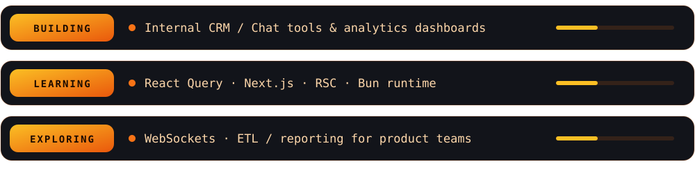

 


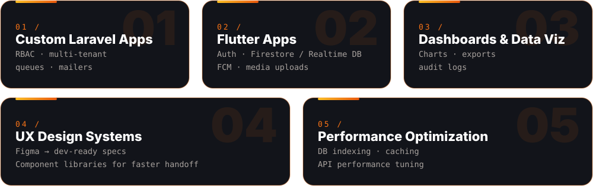

 


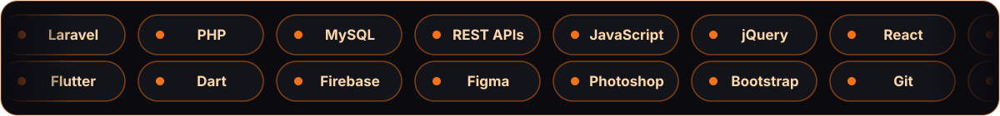

 


  <a href="https://amaanullah.com/portfolio-details.php?slug=tour-guide-mobile-app--explore-pakistan-like-never-before"></a>
  <a href="https://amaanullah.com/portfolio-details.php?slug=chatrox-mobile-app--real-time-communication-on-the-go"></a>
  <a href="https://amaanullah.com/portfolio-details.php?slug=chatrox--real-time-chat--collaboration-web-app"></a>
  <a href="https://amaanullah.com/portfolio-details.php?slug=crm-velspra--sales--leads-management-system"></a>
  <a href="https://amaanullah.com/portfolio-details.php?slug=umrah-al-badal--umrah-service-platform"></a>
  <a href="https://amaanullah.com"></a>

 



 

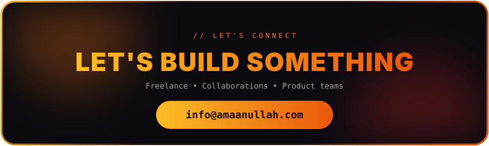

  
  

<strong>Timeline</strong>

 

| Year | Milestone |
|:--|:--|
| **2023** | Started freelancing with Laravel & Flutter |
| **2024** | Built e-commerce platforms & admin dashboards |
| **2025** | Transitioned into product design & mentoring flows |

<i>"Continuous improvement is better than delayed perfection."</i>

<!-- Keywords: Amaanullah AK full-stack developer Pakistan, Laravel developer Pakistan, Flutter Firebase apps, real-time chat, CRM dashboards, MySQL optimization, REST APIs, eCommerce Laravel, UI/UX design. -->
